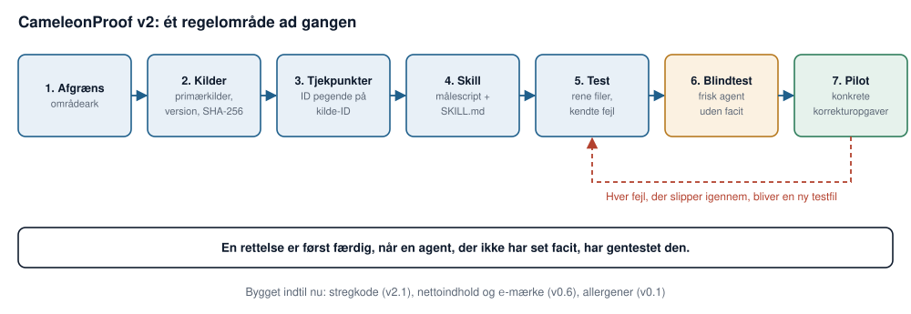
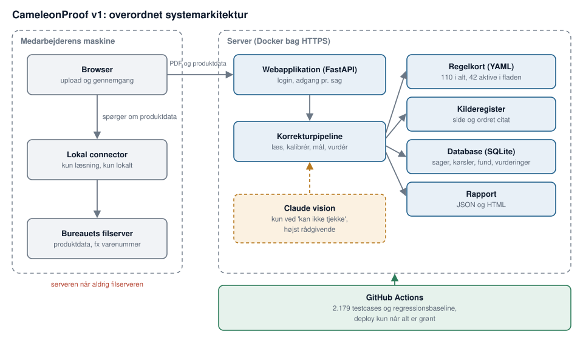
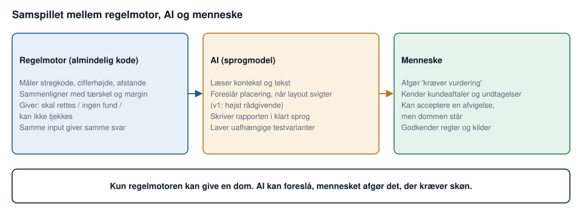
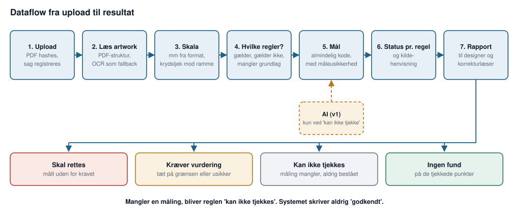

# CameleonProof: automatisk korrektur af emballagedesign

*Case study af Oliver Bruhn Lyngaa Wegeberg, november 2026. [English version](case-study-en.md).*

| Kort fortalt | |
|---|---|
| **Hvad** | Et system, der kontrollerer trykfærdige emballagedesign mod regelbaserede krav, foreløbig stregkoder og dele af fødevaremærkningen. Det siger også tydeligt, hvad det ikke kunne tjekke. |
| **For hvem** | Cameleon Creatives A/S, et emballagedesignbureau i Aarhus. Klientprojekt. |
| **Min rolle** | Jeg fandt behovet, foreslog projektet og står for krav, regler og kilder, systemdesign, test og drift. Koden er skrevet af AI-kodeagenter ud fra mine direktiver. |
| **Periode** | Version 1: februar til september 2026. Version 2: siden november 2026. |
| **Status** | Systemet er under løbende udvikling og afprøves i et pilotforløb med konkrete korrekturopgaver hos Cameleon. Version 1 (websystemet) kom på server i september 2026, men blev ikke taget i brug. |
| **Teknik** | Python, FastAPI, PyMuPDF, zxing-cpp, Tesseract, SQLite, Docker og GitHub Actions. Version 2 er Claude-skills med målescripts. |

> **Om denne case.** Koden, regelbasen og bureauets filer er fortrolige og ligger ikke her. Tal om tidsforbrug er skøn, ikke målte besparelser. Kodeeksemplet i [`example/`](../example/) er et selvstændigt, syntetisk eksempel og ikke CameleonProof-koden.

## 1. Kort introduktion

Før et emballagedesign går i trykken, bliver det læst korrektur. Er stregkoden stor nok og langt nok fra skærelinjen? Stemmer cifrene? Står mængden med store nok tal, og står ℮-mærket rigtigt? Er allergenerne fremhævet? Reglerne står i EU-forordninger, danske bekendtgørelser, GS1-standarden og kundernes egne manualer.

CameleonProof skal finde fejlene, før filen sendes videre. Designeren uploader eller kører en PDF og får tre ting tilbage: hvad der skal rettes, hvad et menneske skal vurdere, og hvad systemet ikke kunne tjekke. Hvert fund peger på den regel og den kilde, det bygger på.

Projektet er bygget i to faser. Den første version var et websystem med mange regler. Den kom på server, men blev ikke taget i brug. Den anden version bygges ét regelområde ad gangen og afprøves nu på konkrete korrekturopgaver. Begge dele står i denne case, fordi forskellen mellem dem er en stor del af det, projektet har lært mig.

## 2. Forretningsproblemet

Korrektur af emballage er specialistarbejde. Det kræver, at man kender reglerne, og det sker under tidspres lige før tryk. En fejl, der slipper igennem, bliver opdaget efter trykning, og så er løsningen et nyt oplag. En fejl, der bliver fanget sent, giver en ekstra korrekturrunde: designeren retter, korrekturlæseren tjekker igen, og begge bliver trukket ud af andet arbejde.

**Problemets størrelse (skøn):**

- Ledelsen anslår, at bureauet laver flere hundrede korrekturer af emballage om året, og at hver tager omkring en time.
- Jeg efterprøvede skønnet med en analyse af bureauets tidsregistreringer og korrekturrunderne på filserveren. Den pegede på samme størrelsesorden.

Det er skøn. De bygger på data fra forskellige perioder og en registreringspraksis, der varierer, og de er ikke bekræftet af Cameleon. Bureauets interne tal vises ikke her. Skønnene beskriver problemets størrelse. De er ikke en besparelse, som systemet har skabt.

## 3. Hvordan jeg identificerede muligheden

Jeg skrev kandidatspeciale hos Cameleon Creatives om prissætning i kreative virksomheder. Specialet blev bedømt i september 2025. Jeg koblede flere års projekt-, tids- og regnskabsdata fra e-conomic og Toggl i Python og undersøgte sammenhængen mellem kontrakttype, projektkompleksitet og rentabilitet.

Undervejs i data så jeg et andet mønster. Korrektur af emballage var en tilbagevendende opgave, der tog specialisttid, og en stor del af den bestod i at kontrollere ting, der står i regler. Det lå uden for specialets scope.

Jeg ville udvikle mig inden for AI og softwareudvikling, så jeg opsøgte selv Cameleon og foreslog at bygge et system til netop den opgave. Projektet er ikke en del af min uddannelse. Cameleon gav mig adgang til data, filer og ledelsen, så jeg kunne bygge og afprøve det i en rigtig virksomhed.

## 4. Data- og procesforståelse

**Processen.** Et design går fra designer til korrekturlæser som PDF. Korrekturlæseren skriver kommentarer, designeren retter, og runden gentages, indtil filen er klar til tryk. Bureauets filer følger faste konventioner, blandt andet en kolofon og et teknisk lag med format og skærelinje. Systemet bruger dem til at aflæse format og målestok.

**Data, jeg har brugt:**

- Tidsregistreringer på korrekturopgaver, koblet til projekter.
- Korrekturrunder og kommentarer på filserveren.
- Rigtige, godkendte designs og rigtige fejl fra korrekturrunder, brugt som testfiler.
- Primærkilder: EU-forordning 1169/2011 om fødevareinformation, danske bekendtgørelser og vejledninger og GS1 General Specifications.

**To indsigter, der ændrede retningen:**

1. **Reglerne er kun en del af korrekturen.** En gennemgang af korrekturrunderne tydede på, at regelbaserede krav kun er en mindre del af det, der rettes i praksis. Resten er kundekrav og layout. Det er et skøn, der ikke er valideret. Derfor lover systemet ikke at erstatte korrekturen, og regler, kundekrav og bureauets egne standarder holdes i hver sit lag.
2. **Designere arbejder på grænsen.** Skriften til mængdeangivelser sættes ofte præcis til minimum. Rene, godkendte filer måler derfor tit lige omkring kravet. Et system med en skarp grænse ville give falske alarmer på korrekte filer. Det førte til en målt fejlmargin og en status for "tæt på grænsen" (afsnit 10).

Til området nettoindhold og ℮-mærke gennemgik jeg rigtige PDF-filer fra filserveren og fandt de steder, hvor korrekturen havde rettet ℮-mærke og mængde. De blev kandidater til testfiler med rigtige fejl.

## 5. Min rolle og samarbejdet med Cameleon

Jeg har bygget projektet alene og har løbende dialog med bureauets ledelse. Jeg har forberedt en interviewguide til korrekturlæserne. I version 2 valgte jeg at bygge et første område og lære af det i stedet for at vente på interviewet. Spørgsmål, der kræver bureauets svar, samler jeg i en liste og mærker "ikke bekræftet af Cameleon", indtil de er afklaret.

**Hvem gjorde hvad:**

| | Hvad | Hvem |
|---|---|---|
| **Besluttet og specificeret** | Problem og afgrænsning, hvilke områder der bygges først, statusmodellen ("aldrig falsk bestået"), at serveren aldrig må nå bureauets filer, testmetode, fejlmargin, hvad AI må og ikke må | Mig |
| **Implementeret** | Kode, tests, rapporter, deployment-opsætning og dokumentation | AI-kodeagenter (Claude Code m.fl.) ud fra mine skrevne direktiver |
| **Gennemgået og testet** | Resultater mod kendte filer, sandfærdighedsrevisioner, blindtest og kildekontrol | Mig, sammen med uafhængige agenter, der ikke kender facit |
| **Dokumenteret og fungerer** | Det, der står i afsnit 11 og 12 | Verificeret i tests og på rigtige filer |

Agenterne skriver koden. Mit review er rettet mod adfærd og påstande: hvad systemet gør på kendte filer, hvad det melder, og om hvert fund kan føres tilbage til en kilde. Jeg står inde for, hvad systemet påstår, og det er dér, det meste af mit arbejde ligger.

## 6. AI-first udviklingsmetoden

**Version 1** blev bygget med skrevne direktiver. Hver opgave havde et afgrænset mål, acceptkriterier og en statusrapport til sidst. Agenterne implementerede, og jeg gennemgik resultatet, kørte testene og besluttede næste skridt. Da systemet voksede, lavede jeg sandfærdighedsrevisioner, hvor agenter skulle finde de steder, hvor systemet kunne sige "bestået" uden grund (afsnit 9).

**Version 2** bygges efter en fast proces pr. område:

Projektmappen har en plan, hvor kun de næste tre opgaver er beskrevet i detaljer, og en proces, som alle områder følger. Der er også regler for agenterne, blandt andet:

- Opfind aldrig regler, grænseværdier, paragraffer eller kilder. Mangler der noget, skrives "ikke verificeret".
- En korrektur må aldrig konkludere "godkendt".
- Kundefiler bliver på maskinen og kommer aldrig i git eller online.
- En rettelse er først færdig, når en frisk agent, der ikke har set facit, har gentestet den. Den, der byggede et område, laver ikke selv kildekontrollen.
- Commit efter hver afsluttet opgave med en fast beskedform.

Jeg kører ofte flere agenter parallelt. Én bygger, én laver testfiler uden at kende målekoden, og én kontrollerer kilderne. To af byggestenene er selv skills, så processen kan gentages: en kildetjekker og en skill, der opretter nye områder.

## 7. Systemarkitektur

**Version 1 (websystemet):**

- Brugerfladen kører i browseren. Bag den ligger en FastAPI-applikation med login og adgang pr. sag. Adgangskoder hashes med scrypt, sessioner er signerede, og første login sker med en engangskode.
- En upload bliver hashet og registreret på en sag. En pipeline læser PDF'en (PyMuPDF), afkoder stregkoden (zxing-cpp), aflæser format og målestok, afgør hvilke regler der gælder, og måler.
- Regler er data, ikke kode. Hvert regelkort (YAML) har tærskler, betingelser og kilde-ID'er, der peger på et kilderegister med side og ordret citat.
- Resultater gemmes i SQLite: sager, kørsler, fund, vurderinger og accepterede undtagelser. Rapporten findes både som JSON og HTML.
- Bureauets produktdata, fx det forventede varenummer, ligger på en intern filserver. Den åbnes aldrig mod serveren. Browseren spørger i stedet et lille program på medarbejderens egen maskine, som kun kan læse og kun svarer lokalt.
- Systemet kører i Docker bag HTTPS. GitHub Actions kører testene og deployer kun, når alt er grønt.

**Version 2 (skills):** Hvert område er en Claude-skill med tre dele:

- `SKILL.md`: instruktionen til modellen. Den siger, hvem brugeren er (grafiker eller korrekturlæser), hvilke statusser der bruges, og hvordan svaret leveres.
- Et målescript i Python, der måler direkte i PDF'en, fx cifferhøjde fra skriftens konturer og afstande fra vektorgeometrien.
- Referencer: kilder, tjekpunkter og kopier af originalerne med SHA-256-kontrolsum.

Næste skridt er en fælles PDF-profil, der måles én gang og bruges af alle områder, og en samleskill, der kører flere områder i én korrektur.

## 8. Regelbaseret kode kontra AI

Hovedreglen er, at **domme kommer fra almindelig kode**. Det er et bevidst valg af fire grunde:

- **Præcision:** krav måles i hundrededele af millimeter.
- **Gentagelighed:** samme fil skal give samme svar.
- **Sporbarhed:** hvert fund skal kunne føres tilbage til en regel og en kilde.
- **Pris:** måling kræver ingen modelkald.

**I version 1** kommer alle "bestået" og "fejl" fra deterministisk Python. Der er kun ét kald til en sprogmodel. Claude vision bruges til at foreslå stregkodens placering, når layoutanalysen ikke kan afgøre den. Svaret skal have en sikkerhed på mindst 0,75 og kan højst blive rådgivende. Loftet kom efter en revision i august 2026, der fandt, at et AI-skøn kunne blive til en blokerende fejl. Uden adgang til modellen bliver svaret "kan ikke tjekke".

**I version 2** måler scripts, og modellen gør det, den er god til. Den læser konteksten, afgør om et tal er nettoindhold eller drænet vægt, beder brugeren se selv efter, når den er i tvivl, og skriver svaret i klart sprog. AI bruges også til to opgaver under udviklingen, som altid kontrolleres:

- Uafhængige agenter laver testfiler med fejl uden at kende målekoden.
- Regler bliver trukket ud af kilderne og kontrolleret mod originalerne af kildetjekkeren.

Et eksempel på, hvorfor målingen er kode. Cifferhøjde målt i pixels var upålidelig på fotobaggrunde. Den måles derfor fra skriftens egne konturer i PDF'en. På den måde afveg målingen højst 0,031 mm fra en uafhængig agents måling.

## 9. Teststrategi og kvalitetssikring

**Version 1:**

- **2.179 automatiske testcases**, det vil sige 1.823 testfunktioner, hvoraf nogle køres med flere input. Ved sidste kørsel bestod 2.129. 48 blev sprunget over, fordi de kræver bureauets filserver eller filer, der ikke ligger i CI.
- **Regressionsbaseline:** For 10 rigtige designs er status for hver regel låst, i alt 1.110 låste resultater. En ændring, der flytter en dom, bliver fanget. Filerne er gået til tryk og antages at være korrekte, men det er ikke uafhængigt verificeret. De er en baseline, ikke en facitliste.
- **Fejlvarianter:** 35 syntetiske kopier af rigtige filer med indsatte fejl tester, at fejl faktisk bliver meldt.
- **Kilderne testes også:** For 40 af de 42 stregkoderegler slår en test kildehenvisningen op i selve kildedokumentet. De to sidste har en skrevet begrundelse for, at de ingen kilde har.
- **Tests styrer deploy.** Fejler en kørsel, går intet ud.

**Sandfærdighedsrevisioner, august og september 2026.** Revisionerne fandt det, testtallet ikke kunne vise:

- Kendte falske "bestået" på stregkoder blev bragt fra 5 til 0.
- Andelen af stregkodekort uden efterprøvet kilde faldt fra 33 af 41 til 3 af 42.
- Revisionen af fødevaremærkningen fandt 5 falske "bestået", som blev afvæbnet.
- En måling viste, at 37 af 52 fødevareregler aldrig havde udløst deres fejlgren i testene. Derfor er fødevaremærkningen ikke slået til i brugerfladen.

Det lærte mig, at mange grønne tests siger noget om mængde, ikke om, hvorvidt systemet fanger fejl.

**Version 2:**

- **Testfilerne er rene, rigtige filer, rigtige fejl fra korrekturrunder og syntetiske varianter.** Varianterne laves af en uafhængig agent, og facit åbnes først efter kørslen.
- **Nettoindhold og ℮-mærke:** I første blindtest fandt skillen 12 af 14 fejlvarianter. Den gav ingen falsk "ret" på de 6 fejlfri. Målingerne afveg højst 0,031 mm for cifre og 0,037 mm for ℮-mærket fra agentens uafhængige måling. Regression køres på 32 filer.
- **Stregkode:** Regression på 45 filer. Måleusikkerheden på 0,05 mm er afprøvet på 14 vektor-PDF'er. En gennemgang mod GS1 General Specifications fandt ti forkerte henvisninger og formuleringer. De er rettet og bagefter kontrolleret af en uafhængig agent.
- **Allergener (version 0.1):** Første testrunde fandt 8 af 10 fejlfiler. Efter rettelser fandt anden runde de gamle fejl, men missede to nye fejlvarianter. De er rettet og gentestet af en ny agent.
- **Kildetjekkeren** fandt alle seks fejl, der var sat ind i en testkopi, og én rigtig fejl i et tjekpunkt.

Hver testrapport skriver også, hvad testen ikke dækker.

## 10. Håndtering af usikkerhed og manuel vurdering

Designprincippet er, at **systemet aldrig må give et falsk "bestået"**. Kan en kontrol ikke gennemføres sikkert, skal det fremgå.

- **Version 1** har seks statusser pr. regel: bestået, fejl, rådgivende, kan ikke tjekkes, kræver manuel vurdering og gælder ikke. Den samlede dom beregnes ud fra dem, aldrig ud fra fraværet af fejl. Ét "kan ikke tjekkes" er nok til at stoppe et "bestået".
- **Et menneske kan bekræfte, men ikke omstøde.** En korrekturlæser kan afgøre punkter, der kræver vurdering, men ikke ændre en dom, som systemet har målt. Accepterer kunden en afvigelse, registreres den som en undtagelse ved siden af dommen, og dommen står.
- **Version 2** bruger statusserne ret, vurder, se selv, efter tryk, ikke målt og ingen fund. Svaret til grafikeren siger altid tre ting: hvad der skal rettes, hvad hun selv skal tage stilling til, og hvad skillen ikke kunne tjekke. Det bedste, systemet kan sige, er "ingen fund på de tjekkede punkter".

**Eksempel: fejlmarginen.** Tal i mængdeangivelsen skal i det aktuelle tilfælde være mindst 4 mm høje. Flere rene filer målte præcis 4 mm, og én målte 3,95 mm.

- En skarp grænse ville give falske alarmer.
- Marginen blev derfor sat til 0,03 mm plus rammens målte afvigelse. Inden for marginen bliver svaret "vurder" med en forklaring, en grafiker kan forstå.
- Kilden siger kun "tal, der er mindst 4 mm høje". Den siger ikke, hvilket ciffer der måles. Det spørgsmål ligger nu hos bureauet og afgøres ikke af systemet.

**Eksempel: standard kontra kundepraksis.** En målt afvigelse fra GS1-standarden kan i praksis være aftalt med kunden. I version 2 er GS1-krav og kundepraksis derfor adskilte tjekpunkter. Systemet melder afvigelsen og lader et menneske afgøre, om den er accepteret.

## 11. Hvad der faktisk er implementeret

| Del | Status |
|---|---|
| Websystem med login, sager, upload, rapport og database | Implementeret, kom på server i september 2026, ikke taget i brug |
| Stregkodemåling (størrelse, højde, lyszoner, afstand til skærelinje, cifre) | Implementeret i begge versioner |
| 110 regelkort i version 1 | 42 stregkoderegler er aktive i brugerfladen. 60 regler om fødevaremærkning findes, men er ikke valideret og vises ikke |
| Kildehenvisning med side og citat | 40 af 42 stregkoderegler, kontrolleret automatisk |
| Lokal connector til produktdata | Implementeret |
| Skill: stregkode | Version 2.1 |
| Skill: nettoindhold og ℮-mærke | Version 0.6 |
| Skill: allergener | Version 0.1 |
| Kildetjekker og byggeskill til nye områder | Version 0.2, bruges i udviklingen |
| Fælles PDF-profil og samleskill | Planlagt |

## 12. Hvad der er testet på rigtige filer

- **Version 1:** 10 rigtige, godkendte designs fra bureauet er regressionsbaseline, og 35 fejlvarianter er lavet ud fra dem. Filer fra andre afsendere med andre filkonventioner er ikke valideret.
- **Version 2:**
  - Nettoindhold er testet på 10 godkendte filer og 3 rigtige fejl fra korrekturrunder og kører regression på 32 filer.
  - Stregkode kører regression på 45 filer.
  - Allergener er kørt på 10 rigtige filer uden falsk "ret". Den kørsel lavede jeg selv, og fejlene i testen er syntetiske.
- **Pilot:** Skills afprøves nu på konkrete korrekturopgaver hos Cameleon. Der er endnu ingen resultater fra piloten at rapportere.

## 13. Hvad der stadig mangler

- **Brug i hverdagen.** Version 1 blev ikke taget i brug. Version 2 afprøves i pilotforløbet, men er ikke en del af den daglige korrektur.
- **Bureauets godkendelse.** Processens trin 6, hvor en person hos Cameleon gennemgår tjekpunkter og kilder, er ikke gennemført for noget område.
- **Flere områder.** Næste er næringsdeklaration, dato og opbevaring og økologi. Kundekrav og layout kommer senere.
- **Tekniske huller i version 2:**
  - Fælles PDF-profil og samleskill.
  - Tekst, der er konverteret til kurver.
  - Fuld understøttelse af UPC-A.
  - En afklaring af, hvilken GS1-udgave der er den nyeste.
- **Version 1 før bredere brug:** Fødevareregler, logogenkendelse, andre filformater og en række kendte drifts- og sikkerhedspunkter skal være på plads.

## 14. Forventet forretningsværdi

Værdien skal komme fire steder fra:

- Fejl bliver fundet, før filen går videre.
- Der bliver færre ekstra korrekturrunder.
- Specialisterne kan bruge deres tid på det, der kræver skøn.
- Der bliver færre fejltryk.

Ingen af delene er målt endnu.

Piloten skal give de første tal:

- Fund pr. fil.
- Falske alarmer.
- Tid pr. korrektur med og uden systemet.
- Antal runder pr. projekt.

Den største risiko er ikke, at systemet overser noget, men at folk holder op med at stole på det på grund af falske alarmer. Derfor er margin og "kan ikke tjekkes" bygget ind fra starten.

## 15. Hvad projektet viser om min måde at arbejde på

- **Jeg finder problemet i data og tager det videre selv.** Muligheden lå uden for specialets scope, og jeg foreslog selv projektet.
- **Jeg bygger med AI-agenter, men ejer sandheden.** Agenterne skriver koden. Jeg bestemmer, hvad systemet må påstå, og jeg tjekker, at det holder.
- **Jeg vælger almindelig kode, når præcision betyder mest,** og AI, når der skal læses, vurderes og formidles.
- **Jeg melder fejl, også mine egne.** Version 1 blev ikke brugt. I stedet for at pynte på det byggede jeg version 2 smallere, tættere på opgaven og med uafhængig test.
- **Jeg gør arbejdet gentageligt.** Proces, skabeloner, regler for agenterne og skills, der bygger nye områder, gør, at næste område bliver bygget på samme måde.

*Spørgsmål og demo: [linkedin.com/in/oliver-bruhn-71607317a](https://linkedin.com/in/oliver-bruhn-71607317a)*
