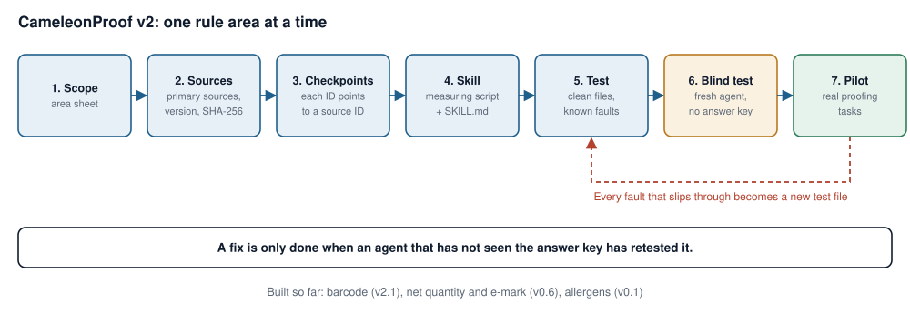
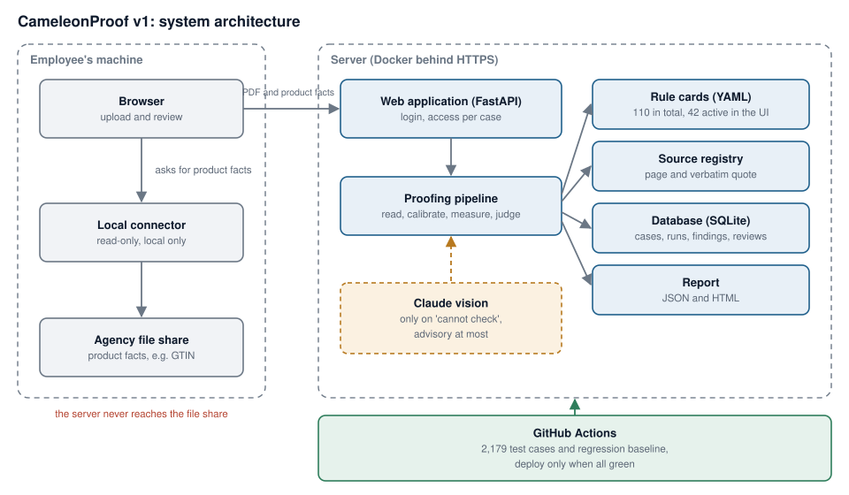
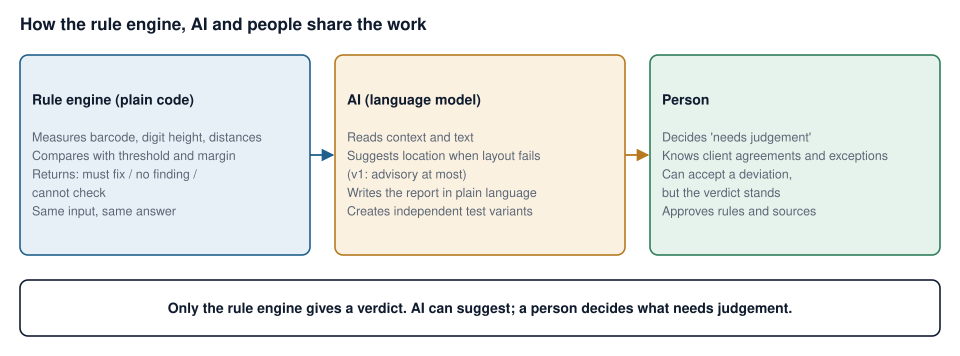
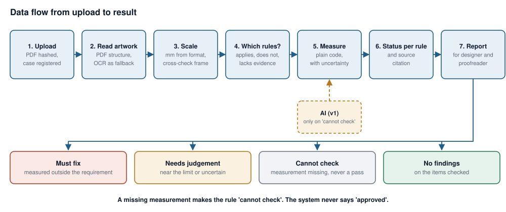

# CameleonProof: automated proofing of packaging artwork

*Case study by Oliver Bruhn Lyngaa Wegeberg, November 2026. [Danish version](case-study-da.md).*

| At a glance | |
|---|---|
| **What** | A system that checks print-ready packaging artwork against rule-based requirements, so far barcodes and parts of the food labelling rules. It also says clearly what it could not check. |
| **For whom** | Cameleon Creatives A/S, a packaging design agency in Aarhus, Denmark. Client project. |
| **My role** | I found the need, proposed the project, and own the requirements, rules and sources, system design, testing and operations. The code is written by AI coding agents from my directives. |
| **Period** | Version 1: February to September 2026. Version 2: since November 2026. |
| **Status** | The system is under continuous development and is being piloted on real proofing tasks at Cameleon. Version 1 (the web system) was deployed to a server in September 2026 but was not taken into use. |
| **Technology** | Python, FastAPI, PyMuPDF, zxing-cpp, Tesseract, SQLite, Docker and GitHub Actions. Version 2 is built as Claude skills with measuring scripts. |

> **About this case.** The code, the rule base and the agency's files are confidential and are not included here. Figures on time spent are estimates, not measured savings. The code in [`example/`](../example/) is a standalone, synthetic example and not the CameleonProof code.

## 1. Introduction

Before packaging artwork goes to print, someone proofreads it. Is the barcode large enough and far enough from the cut line? Are the digits right? Is the quantity printed in large enough figures, and is the ℮-mark correct? Are the allergens emphasised? The rules live in EU regulations, Danish executive orders, the GS1 standard and the clients' own manuals.

CameleonProof is meant to find those errors before the file moves on. The designer uploads or runs a PDF and gets three things back: what must be fixed, what a person needs to judge, and what the system could not check. Every finding points to the rule and the source behind it.

The project has two phases. The first version was a web system with many rules. It was deployed but never taken into use. The second version is built one rule area at a time and is now being tried on real proofing tasks. Both are described here, because the difference between them is a large part of what the project taught me.

## 2. The business problem

Proofing packaging is specialist work. It takes knowledge of the rules, and it happens under time pressure just before print. An error that slips through is found after printing, and the fix is a reprint. An error caught late costs an extra proofing round: the designer fixes it, the proofreader checks again, and both are pulled away from other work.

**Size of the problem (estimates):**

- Management estimates that the agency proofs several hundred packaging designs a year, at about an hour each.
- I tested that estimate against the agency's time registrations and the proofing rounds on its file server. The analysis pointed to the same order of magnitude.

These are estimates. They rest on data from different periods and on registration practices that vary, and Cameleon has not confirmed them. The agency's internal figures are not shown here. The estimates describe the size of the problem. They are not a saving the system has delivered.

## 3. How I identified the opportunity

I wrote my master's thesis at Cameleon Creatives on pricing in creative firms. The thesis was graded in September 2025. I combined several years of project, time and accounting data from e-conomic and Toggl in Python and studied how contract type, project complexity and profitability relate.

While working with the data I saw another pattern. Proofing packaging was a recurring task that took specialist time, and much of it consisted of checking things that are written down as rules. That was outside the scope of the thesis.

I wanted to develop my skills in AI and software development, so I approached Cameleon myself and proposed building a system for exactly that task. The project is not part of my degree. Cameleon gave me access to data, files and management, so I could build and test it in a real company.

## 4. Understanding the data and the process

**The process.** A design goes from designer to proofreader as a PDF. The proofreader comments, the designer corrects, and the round repeats until the file is ready to print. The agency's files follow fixed conventions, including a colophon and a technical layer with format and cut line. The system uses them to read format and scale.

**Data I used:**

- Time registrations on proofing tasks, linked to projects.
- Proofing rounds and comments on the file server.
- Real, approved designs and real errors from proofing rounds, used as test files.
- Primary sources: EU Regulation 1169/2011 on food information, Danish executive orders and guidance, and the GS1 General Specifications.

**Two insights that changed the direction:**

1. **Rules are only part of proofing.** A review of the proofing rounds suggested that rule-based requirements are a minor part of what gets corrected in practice. The rest is client requirements and layout. This is an estimate that has not been validated. So the system does not promise to replace proofing, and rules, client requirements and the agency's own standards are kept in separate layers.
2. **Designers work at the limit.** Type for quantity statements is often set exactly at the minimum. Clean, approved files therefore often measure right around the requirement. A system with a hard cut-off would raise false alarms on correct files. That led to a measured error margin and a status for "close to the limit" (section 10).

For the net quantity and ℮-mark area I went through real PDF files from the file server and found the places where proofing had corrected the ℮-mark and quantity. They became candidates for test files with real errors.

## 5. My role and the collaboration with Cameleon

I have built the project alone and am in ongoing dialogue with the agency's management. I have prepared an interview guide for the proofreaders. In version 2 I chose to build a first area and learn from it rather than wait for the interview. Questions that need the agency's answer are collected in a list and marked "not confirmed by Cameleon" until they are settled.

**Who did what:**

| | What | Who |
|---|---|---|
| **Decided and specified** | The problem and scope, which areas come first, the status model ("never a false pass"), that the server must never reach the agency's files, the test method, the error margin, what AI may and may not do | Me |
| **Implemented** | Code, tests, reports, deployment setup and documentation | AI coding agents (Claude Code and others) from my written directives |
| **Reviewed and tested** | Results against known files, truthfulness audits, blind tests and source checks | Me, together with independent agents that do not see the answer key |
| **Documented and working** | What is listed in sections 11 and 12 | Verified by tests and on real files |

The agents write the code. My review focuses on behaviour and claims: what the system does on known files, what it reports, and whether every finding can be traced to a source. I stand behind what the system claims, and that is where most of my work goes.

## 6. The AI-first development method

**Version 1** was built from written directives. Each task had a bounded goal, acceptance criteria and a status report at the end. The agents implemented, and I reviewed the result, ran the tests and decided the next step. As the system grew, I ran truthfulness audits in which agents looked for places where the system could say "pass" without reason (section 9).

**Version 2** follows a fixed process for each area:

The project folder has a plan in which only the next three tasks are described in detail, and a process that every area follows. It also has rules for the agents, among them:

- Never invent rules, thresholds, legal references or sources. If something is missing, write "not verified".
- A proofing result may never conclude "approved".
- Client files stay on the machine and never go into git or online.
- A fix is only done when a fresh agent that has not seen the answer key has retested it. Whoever built an area does not do its source check.
- Commit after each finished task with a fixed message format.

I often run several agents in parallel. One builds, one creates test files without knowing the measuring code, and one checks the sources. Two of the building blocks are skills themselves, so the process can be repeated: a source checker and a skill that sets up new areas.

## 7. System architecture

**Version 1 (the web system):**

- The interface runs in the browser. Behind it is a FastAPI application with login and access per case. Passwords are hashed with scrypt, sessions are signed, and the first login uses a one-time code.
- An upload is hashed and registered on a case. A pipeline reads the PDF (PyMuPDF), decodes the barcode (zxing-cpp), reads format and scale, decides which rules apply, and measures.
- Rules are data, not code. Each rule card (YAML) holds thresholds, conditions and source IDs that point to a source registry with page and verbatim quote.
- Results are stored in SQLite: cases, runs, findings, reviews and accepted exceptions. The report exists as both JSON and HTML.
- The agency's product facts, such as the expected product number, sit on an internal file share. It is never opened to the server. Instead, the browser asks a small program on the employee's own machine, which is read-only and only answers locally.
- The system runs in Docker behind HTTPS. GitHub Actions runs the tests and deploys only when everything is green.

**Version 2 (skills):** Each area is a Claude skill with three parts:

- `SKILL.md`: the instructions for the model. They state who the user is (a designer or proofreader), which statuses are used, and how the answer is delivered.
- A Python measuring script that measures directly in the PDF, for example digit height from the font outlines and distances from the vector geometry.
- References: sources, checkpoints and copies of the originals with SHA-256 checksums.

Next steps are a shared PDF profile that is measured once and used by every area, and a combined skill that runs several areas in one proof.

## 8. Rule-based code versus AI

The main rule is that **verdicts come from plain code**. That is a deliberate choice, for four reasons:

- **Precision:** requirements are measured in hundredths of a millimetre.
- **Repeatability:** the same file must give the same answer.
- **Traceability:** every finding must lead back to a rule and a source.
- **Cost:** measuring needs no model calls.

**In version 1** every "pass" and "fail" comes from deterministic Python. There is only one call to a language model. Claude vision is used to suggest where the barcode sits when layout analysis cannot tell. The answer needs a confidence of at least 0.75 and can be advisory at most. The cap came after an audit in August 2026 found that an AI estimate could turn into a blocking failure. Without access to the model, the answer is "cannot check".

**In version 2** scripts measure, and the model does what it is good at. It reads the context, decides whether a number is net quantity or drained weight, asks the user to look for themselves when it is unsure, and writes the answer in plain language. AI is also used for two development tasks that are always checked:

- Independent agents create test files with errors without knowing the measuring code.
- Rules are extracted from the sources and checked against the originals by the source checker.

An example of why measuring is code. Digit height measured in pixels was unreliable on photo backgrounds. It is therefore measured from the font's own outlines in the PDF. Measured that way, it differed by at most 0.031 mm from an independent agent's measurement.

## 9. Test strategy and quality assurance

**Version 1:**

- **2,179 automated test cases**, from 1,823 test functions, some of which run with several inputs. In the latest run, 2,129 passed. 48 were skipped because they need the agency's file share or files that are not in CI.
- **Regression baseline:** For 10 real designs, the status of every rule is locked, 1,110 locked results in total. A change that moves any verdict is caught. The files went to print and are presumed correct, but that has not been verified independently. They are a baseline, not an answer key.
- **Fault variants:** 35 synthetic copies of real files with inserted faults test that faults are actually reported.
- **Sources are tested too:** For 40 of the 42 barcode rules a test looks up the citation in the source document itself. The other two have a written reason why they have no source.
- **Tests gate deployment.** If a run fails, nothing is released.

**Truthfulness audits, August and September 2026.** The audits found what the test count could not show:

- Known false passes on barcodes went from 5 to 0.
- Barcode rule cards without a verified source went from 33 of 41 to 3 of 42.
- The food labelling audit found 5 false passes, which were disarmed.
- A measurement showed that 37 of 52 food labelling rules had never triggered their failure branch in the tests. That is why food labelling is not switched on in the interface.

It taught me that a large number of green tests says something about volume, not about whether the system catches errors.

**Version 2:**

- **Test files are clean real files, real errors from proofing rounds, and synthetic variants.** The variants are made by an independent agent, and the answer key is opened only after the run.
- **Net quantity and ℮-mark:** In the first blind test the skill found 12 of 14 fault variants. It raised no false "fix" on the 6 clean ones. Measurements differed by at most 0.031 mm for digits and 0.037 mm for the ℮-mark from the agent's independent measurement. Regression runs on 32 files.
- **Barcode:** Regression runs on 45 files. The measurement uncertainty of 0.05 mm was tested on 14 vector PDFs. A review against the GS1 General Specifications found ten wrong references and wordings. They were corrected and then checked by an independent agent.
- **Allergens (version 0.1):** The first test round found 8 of 10 fault files. After fixes, the second round found the old faults but missed two new fault variants. Those were fixed and retested by a new agent.
- **The source checker** found all six faults planted in a test copy, and one real fault in a checkpoint.

Every test report also states what the test does not cover.

## 10. Handling uncertainty and human judgement

The design principle is that **the system must never give a false pass**. If a check cannot be carried out reliably, that must be visible.

- **Version 1** has six statuses per rule: pass, fail, advisory, cannot check, manual review required and not applicable. The overall verdict is computed from them, never from the absence of failures. A single "cannot check" is enough to stop a pass.
- **A person can confirm, but cannot overrule.** A proofreader can resolve items that need judgement, but cannot change a verdict the system has measured. If the client accepts a deviation, it is recorded as an exception next to the verdict, and the verdict stands.
- **Version 2** uses the statuses fix, judge, look yourself, after print, not measured and no findings. The answer to the designer always says three things: what to fix, what she needs to decide herself, and what the skill could not check. The best the system can say is "no findings on the items checked".

**Example: the error margin.** In the case at hand, the figures in the quantity statement must be at least 4 mm tall. Several clean files measured exactly 4 mm, and one measured 3.95 mm.

- A hard cut-off would give false alarms.
- The margin was therefore set to 0.03 mm plus the measured deviation of the frame. Inside the margin the answer is "judge", with an explanation a designer can follow.
- The source only says "figures at least 4 mm tall". It does not say which digit is measured. That question now sits with the agency and is not settled by the system.

**Example: standard versus client practice.** A measured deviation from the GS1 standard may in practice be agreed with the client. In version 2, GS1 requirements and client practice are therefore separate checkpoints. The system reports the deviation and leaves it to a person to decide whether it is accepted.

## 11. What is actually implemented

| Part | Status |
|---|---|
| Web system with login, cases, upload, report and database | Implemented, deployed in September 2026, not taken into use |
| Barcode measurement (size, height, quiet zones, distance to cut line, digits) | Implemented in both versions |
| 110 rule cards in version 1 | 42 barcode rules are active in the interface. 60 food labelling rules exist but are not validated and not shown |
| Source citation with page and quote | 40 of 42 barcode rules, checked automatically |
| Local connector for product facts | Implemented |
| Skill: barcode | Version 2.1 |
| Skill: net quantity and ℮-mark | Version 0.6 |
| Skill: allergens | Version 0.1 |
| Source checker and builder skill for new areas | Version 0.2, used in development |
| Shared PDF profile and combined skill | Planned |

## 12. What has been tested on real files

- **Version 1:** 10 real, approved designs from the agency are the regression baseline, and 35 fault variants are derived from them. Files from other senders with other file conventions have not been validated.
- **Version 2:**
  - Net quantity is tested on 10 approved files and 3 real errors from proofing rounds, and runs regression on 32 files.
  - Barcode runs regression on 45 files.
  - Allergens has been run on 10 real files with no false "fix". I ran that myself, and the faults in the test are synthetic.
- **Pilot:** The skills are now being tried on real proofing tasks at Cameleon. There are no pilot results to report yet.

## 13. What is still missing

- **Everyday use.** Version 1 was not taken into use. Version 2 is being tried in the pilot but is not part of day-to-day proofing.
- **The agency's sign-off.** Step 6 of the process, in which a person at Cameleon reviews checkpoints and sources, has not been done for any area.
- **More areas.** Next are the nutrition declaration, dates and storage, and organic labelling. Client requirements and layout come later.
- **Technical gaps in version 2:**
  - The shared PDF profile and combined skill.
  - Text converted to outlines.
  - Full UPC-A support.
  - Settling which GS1 edition is the latest.
- **Version 1 before wider use:** Food labelling rules, logo detection, other file formats and a number of known operational and security items need to be in place.

## 14. Expected business value

The value is meant to come from four places:

- Errors are found before the file moves on.
- There are fewer extra proofing rounds.
- Specialists can spend their time on what needs judgement.
- There are fewer misprints.

None of this has been measured yet.

The pilot should produce the first numbers:

- Findings per file.
- False alarms.
- Time per proof with and without the system.
- Rounds per project.

The biggest risk is not that the system misses something, but that people stop trusting it because of false alarms. That is why the margin and "cannot check" are built in from the start.

## 15. What the project shows about how I work

- **I find the problem in the data and take it further myself.** The opportunity was outside the scope of my thesis, and I proposed the project myself.
- **I build with AI agents, but I own the truth.** The agents write the code. I decide what the system may claim, and I check that it holds.
- **I choose plain code when precision matters most,** and AI when there is reading, judgement and explaining to do.
- **I report failures, including my own.** Version 1 was not used. Instead of dressing that up, I built version 2 narrower, closer to the task and with independent testing.
- **I make the work repeatable.** A process, templates, rules for the agents and skills that build new areas mean that the next area is built the same way.

*Questions and demo: [linkedin.com/in/oliver-bruhn-71607317a](https://linkedin.com/in/oliver-bruhn-71607317a)*
