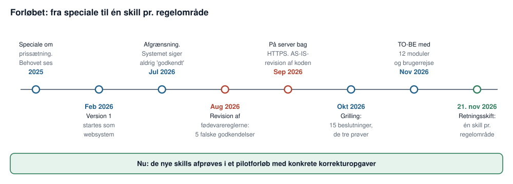
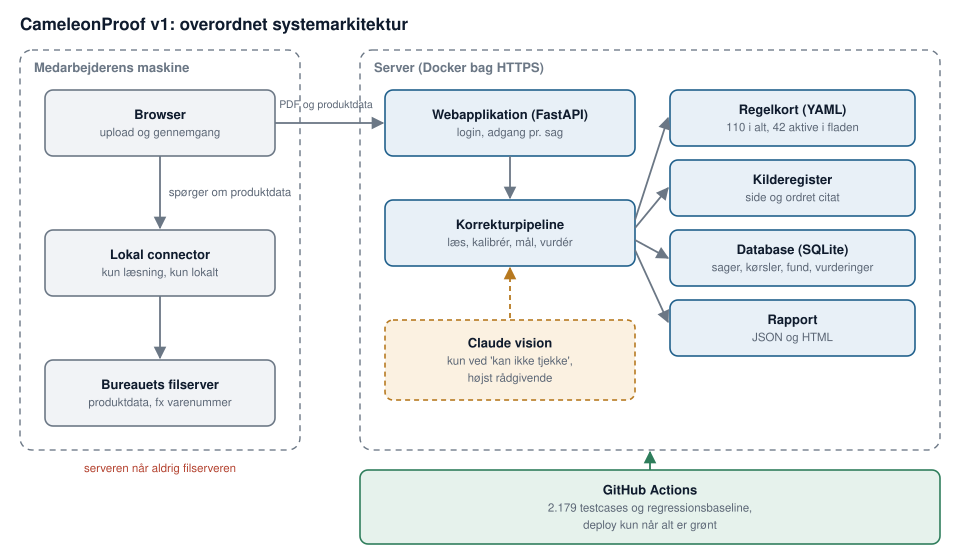
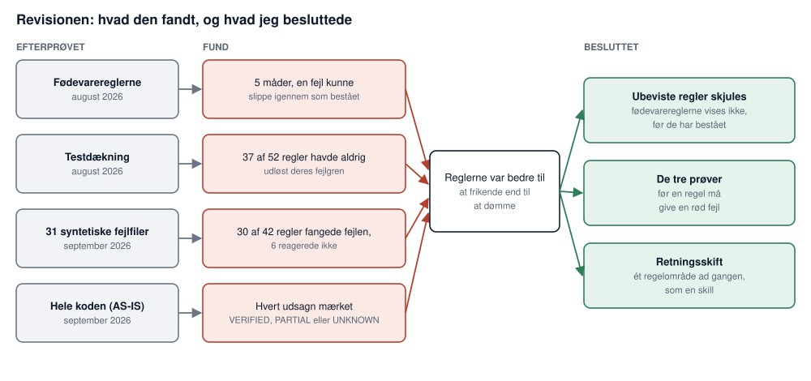
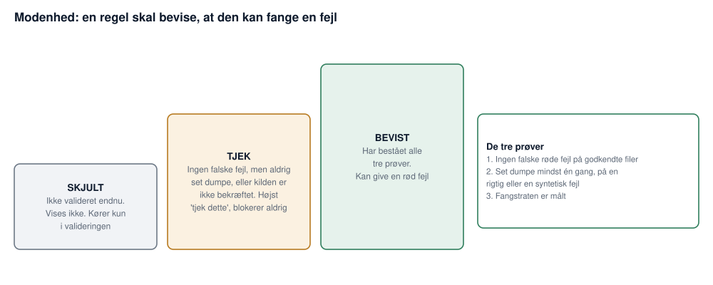
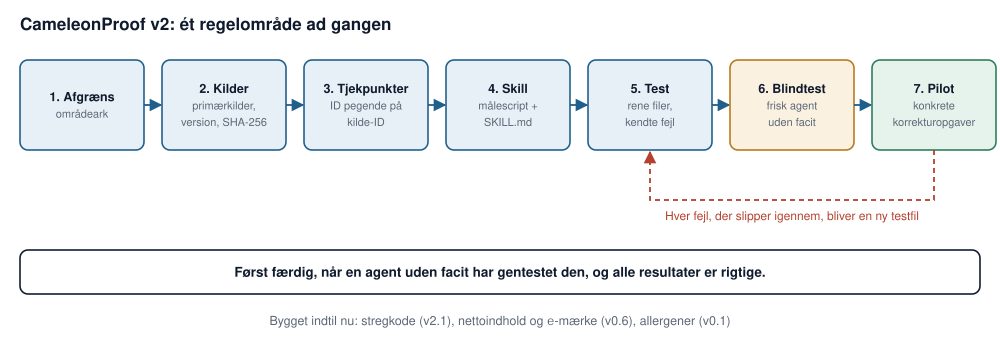
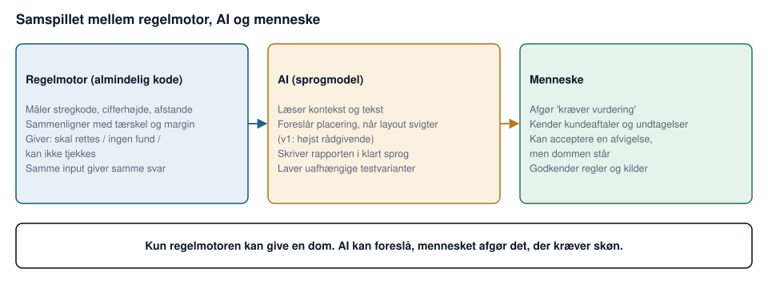

# CameleonProof: korrektur af emballagedesign med AI-agenter og almindelig kode

*Case study af Oliver Bruhn Lyngaa Wegeberg, cand.merc. og AI-first udvikler, november 2026. Websiden med demo og kode: [oliverbruhn-coder.github.io/cameleonproof-portfolio](https://oliverbruhn-coder.github.io/cameleonproof-portfolio/).*

| Kort fortalt | |
|---|---|
| **Hvad** | Et system, der kontrollerer trykfærdige emballagedesign mod regelbaserede krav, og som altid siger, hvad det ikke kunne tjekke |
| **For hvem** | Cameleon Creatives A/S, et emballagedesignbureau i Aarhus. Klientprojekt |
| **Min rolle** | Jeg fandt behovet og foreslog projektet. Jeg står for problem, krav, beslutninger og kontrol. AI-kodeagenter har skrevet koden ud fra mine direktiver |
| **Periode** | Version 1: februar til september 2026. Version 2: siden november 2026 |
| **Status** | Systemet er under løbende udvikling og afprøves i et pilotforløb med konkrete korrekturopgaver hos Cameleon. Version 1 kom på server i september 2026, men blev ikke taget i brug |
| **Teknik** | Python, FastAPI, PyMuPDF, zxing-cpp, Tesseract, SQLite, Docker og GitHub Actions. Version 2 er Claude-skills med målescripts |

> Koden, regelbasen og bureauets filer i det fulde system er fortrolige. Bureauets interne tal og kundedata vises ikke. Tal om tidsforbrug er skøn, ikke målte besparelser.

## 1. Kort fortalt

Før et emballagedesign går i trykken, bliver det læst korrektur. Er stregkoden stor nok og langt nok fra skærelinjen? Står mængden med store nok tal, og står ℮-mærket rigtigt? Er allergenerne fremhævet? CameleonProof skal finde fejlene, før filen sendes videre, og svare med tre ting: hvad der skal rettes, hvad et menneske skal vurdere, og hvad systemet ikke kunne tjekke.

Projektet er bygget i to faser. Den første version var et websystem, der kom på server, men ikke blev taget i brug. Min egen revision viste, hvorfor reglerne ikke var gode nok, og projektet skiftede retning. Den anden version bygges ét regelområde ad gangen. Forskellen mellem de to er en stor del af det, projektet har lært mig, så begge står her.

## 2. Problemet

Korrektur er specialistarbejde under tidspres. En fejl, der slipper igennem, bliver først opdaget efter trykning. En fejl, der bliver fanget sent, giver en ekstra korrekturrunde. Ledelsen anslår, at bureauet laver flere hundrede korrekturer af emballage om året á cirka en time. Det er et skøn.

Jeg skrev kandidatspeciale hos bureauet om prissætning i kreative virksomheder og koblede flere års projekt-, tids- og regnskabsdata i Python. Specialet blev bedømt i september 2025 og endte i en prisramme, som ledelsen bruger i dag. Undervejs så jeg, at korrektur var en tilbagevendende opgave, hvor en stor del bestod i at kontrollere ting, der står i regler. Det lå uden for specialet, så jeg foreslog selv projektet.

## 3. Analysen

Jeg brugte bureauets egne data til at forstå opgaven: tidsregistreringer på korrekturopgaver for at efterprøve ledelsens skøn (samme størrelsesorden), korrekturrunderne på filserveren for at se, hvad der rettes (kommentarerne er klassificeret med AI og ikke efterprøvet af et menneske), og primærkilderne: EU-forordning 1169/2011, danske bekendtgørelser og GS1 General Specifications. Data og fund fra kunderne vises ikke.

To indsigter ændrede retningen:

- **Reglerne er kun en del af korrekturen.** Resten er kundekrav og layout. Derfor lover systemet ikke at erstatte korrekturen, og regler, kundekrav og bureauets standarder holdes i hver sit lag.
- **Designere arbejder på grænsen.** Skriften til mængdeangivelser sættes tit præcis til minimum. En skarp grænse ville give falske alarmer, så der er en målt fejlmargin og en status for "tæt på grænsen".

**Beslutning (17. september 2026):** Systemet må aldrig selv give bureauets godkendelse til tryk. Den er bureauets ansvar.

## 4. Version 1: websystemet

- **Regler er data.** 110 regelkort i YAML med tærskler, betingelser og kilde-ID'er. 42 stregkoderegler er slået til i brugerfladen. For 40 af dem slår en test kildehenvisningen op i selve kildedokumentet.
- **Python og FastAPI** med login og adgang pr. sag. PyMuPDF læser PDF'en, zxing-cpp afkoder stregkoden, Tesseract er fallback. Resultater i SQLite. Docker bag HTTPS.
- **2.179 automatiske testcases**, en regressionsbaseline med 1.110 låste resultater på 10 rigtige designs og syntetiske fejlvarianter. GitHub Actions deployer kun, når alt er grønt.
- **AI kun ét sted:** Claude vision foreslår stregkodens placering, når layoutanalysen giver "kan ikke tjekke". Svaret kan højst blive rådgivende.

**Beslutning (21. september 2026):** Serveren må aldrig kunne nå bureauets filserver. Et lille læseprogram på medarbejderens maskine henter produktdata lokalt.

**Beslutning (9. juli 2026):** Systemet siger aldrig "godkendt". Uden fund bliver dommen "afventer manuel bekræftelse". Et menneske kan afgøre det, der kræver vurdering, men ikke omstøde en målt dom.

## 5. Revisionen

Da systemet voksede, satte jeg agenter til at revidere det. Hvor kan systemet sige "bestået" uden grund? Kan en regel overhovedet dømme?

- Fødevarereglerne havde fem måder, en fejl kunne slippe igennem som bestået. Fx blev nettomængden "fundet" i næringsdeklarationens "pr. 100 g". Alle fem blev afvæbnet.
- 37 af 52 fødevareregler havde aldrig udløst deres fejlgren. Grenene, der frikender, var afprøvet. Grenene, der dømmer, var ikke.
- I en test med 31 syntetiske fejlfiler fangede 30 af 42 stregkoderegler fejlen. 6 reagerede ikke.
- Kendte falske "bestået" på stregkoder gik fra 5 til 0, og kort uden efterprøvet kilde fra 33 af 41 til 3 af 42.
- AS-IS-revisionen gennemgik hele koden og mærkede hvert udsagn VERIFIED, PARTIAL eller UNKNOWN.

Det lærte mig, at mange grønne tests siger noget om mængde, ikke om, hvorvidt systemet fanger fejl.

**Beslutning (oktober 2026):** En regel må først give en rød fejl, når den har bestået tre prøver: ingen falske fejl på godkendte filer, set dumpe mindst én gang, og fangstraten er målt. Fødevarereglerne skjules som ubeviste, indtil de består.

## 6. Nyt design og retningsskift

Efter revisionen afklarede jeg 15 beslutninger og skrev et TO-BE med 12 moduler, der beskrev version 2 som en videreudvikling af websystemet. Det indførte modenhedstrappen (skjult, tjek, bevist), fem tilstande for noget, der mangler (ikke endnu, andres ansvar, ikke relevant, mangler, forkert), og en brugerrejse på fire trin i stedet for syv.

**Beslutning (21. november 2026):** Retningsskift. Jeg venter ikke på et interview eller en gennemgang hos bureauet. Ét regelområde ad gangen bygges som en Claude-skill. TO-BE's principper følger med. Først kun regelbaserede krav: lov, standarder og mærkningsordninger.

## 7. Version 2 i dag

Hvert område er en skill med tre dele: `SKILL.md` (vejledningen til modellen), et målescript i Python og referencer med kilder, tjekpunkter og kontrolsummer. Scriptet måler og giver status. Modellen ser på billederne, spørger om det, der mangler, og forklarer. Statusserne er ret, vurder, se selv, efter tryk, ikke målt og ingen fund. Det bedste, systemet kan sige, er "ingen fund på de tjekkede punkter".

| Område | Version | Testet |
|---|---|---|
| Stregkode (GS1) | 2.1 | Regression på 45 filer. Måleusikkerhed på 0,05 mm afprøvet på 14 vektor-PDF'er. Ti forkerte GS1-henvisninger fundet, rettet og kontrolleret af en uafhængig agent |
| Nettoindhold og ℮-mærke | 0.6 | Første blindtest fandt 12 af 14 fejlvarianter, ingen falsk "ret" på 6 fejlfri. Højst 0,037 mm fra en uafhængig agents måling |
| Allergener | 0.1 | Første runde fandt 8 af 10 fejlfiler. Anden runde missede to nye varianter, som er rettet og gentestet |

**Beslutning (22. november 2026):** En rettelse er først færdig, når en frisk agent, der ikke har set facit, har gentestet den.

**Offentlig udgave.** Stregkode-skillen ligger i repoet med kun GS1-laget. Kundepraksis og bureauets skabeloner er taget ud. Den giver samme mål og statusser som den interne udgave på alle 20 testfiler, og 8 automatiske tests består. Websiden viser en kørsel på en opdigtet etiket: koden er for lav (ret), og den sidder 5 mm fra kanten (vurder).

## 8. Sådan arbejder jeg

Jeg er cand.merc., ikke uddannet programmør. Koden og de fleste dokumenter er skrevet af AI-kodeagenter, især Claude Code. I version 1 er Claude medforfatter på 133 af 175 commits. Min del er problemet, kravene, beslutningerne og kontrollen.

Regler for agenterne er skrevet ned: opfind aldrig regler, grænser eller kilder, konkludér aldrig "godkendt", kundefiler bliver på maskinen, og den, der byggede et område, laver ikke selv kildekontrollen. Jeg kører ofte flere agenter parallelt: én bygger, én laver testfiler uden at kende målekoden, og én kontrollerer kilderne.

**Udvalgte beslutninger fra loggen:**

| Dato | Beslutning |
|---|---|
| 9. jul 2026 | Først kun bureauets egne filer. Andre formater får ærlige "kan ikke tjekke" i stedet for gæt |
| 7. aug 2026 | Rigtige designs er en baseline, ikke en facitliste. Det førte til tests med syntetiske fejl |
| 17. sep 2026 | Ikke låst til én kunde. Der startes ét sted, men arkitekturen bindes ikke |
| 26. sep 2026 | Kanten måles til den faktiske stanselinje, også på runde og formede etiketter |
| okt 2026 | Kode til tal og geometri. AI til sprog som forslag, og et menneske bekræfter |
| 21. nov 2026 | Et område vælges ikke kun efter, hvor tit det nævnes i korrekturer |
| 22. nov 2026 | Måleusikkerheden siges altid, så en grafiker forstår den |

## 9. Status og begrænsninger

- **Brug:** Version 1 blev ikke taget i brug. Version 2 afprøves i pilotforløbet, men er ikke en del af den daglige korrektur. Der er endnu ingen pilotresultater.
- **Bureauets godkendelse:** Ingen områder er gennemgået af en fagperson hos bureauet.
- **Dækning:** Kun regelbaserede krav i de nævnte områder. Kundekrav og layout er ikke med.
- **Afprøvning:** Måleusikkerheden er afprøvet på vektor-PDF'er, ikke på billedfiler, tryk eller med en verifier.
- **Forretningsværdi:** Færre fejl, færre ekstra runder og mere tid til det, der kræver skøn. Intet er målt endnu. Piloten skal give de første tal: fund pr. fil, falske alarmer og tid pr. korrektur.

Den største risiko er ikke, at systemet overser noget, men at folk holder op med at stole på det på grund af falske alarmer. Derfor er margin, "kan ikke tjekke" og de tre prøver bygget ind.

*Kontakt og demo: [linkedin.com/in/oliver-bruhn-71607317a](https://linkedin.com/in/oliver-bruhn-71607317a)*
