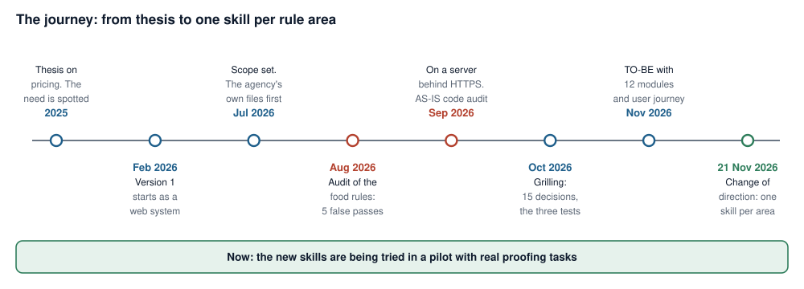
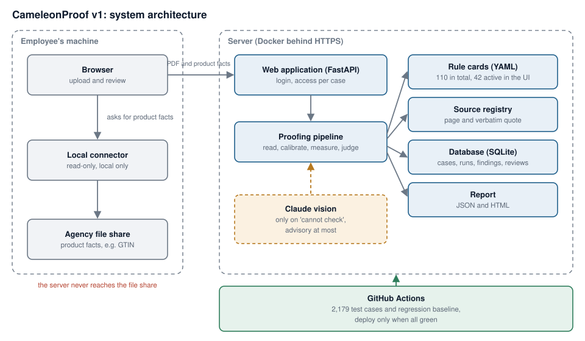
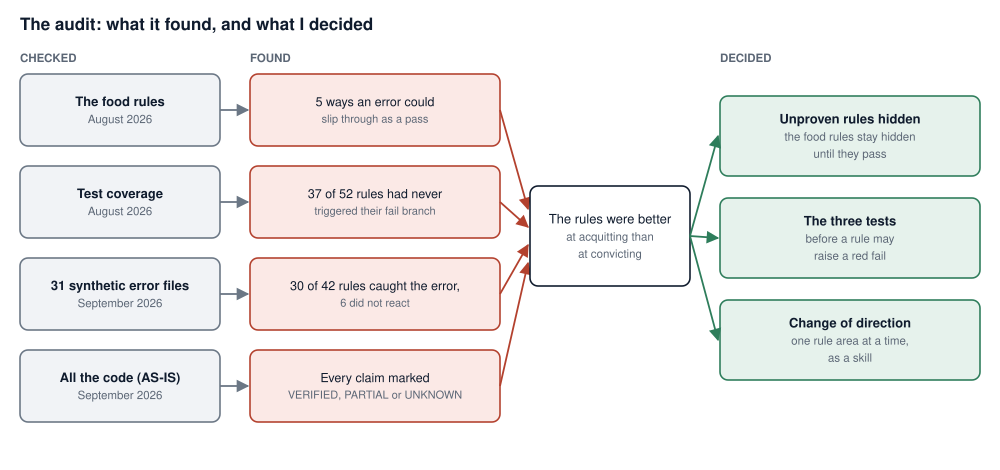
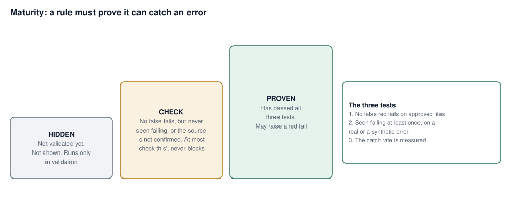
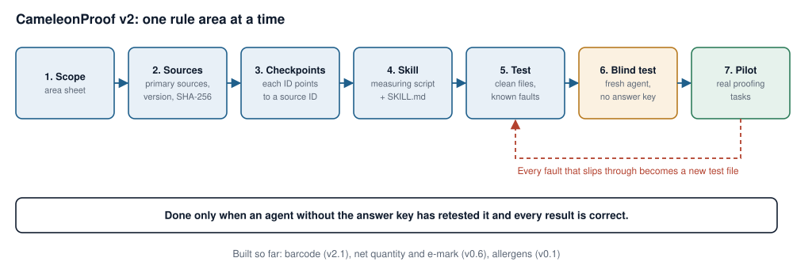
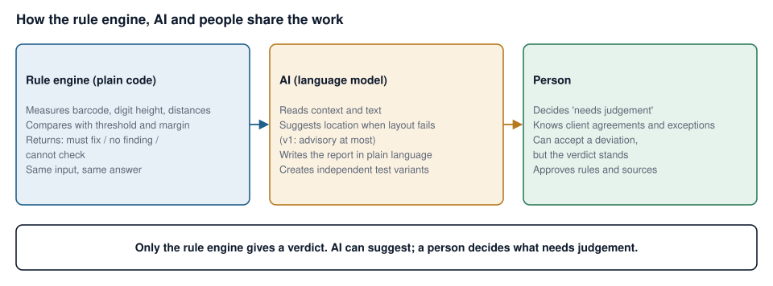

# CameleonProof: proofing packaging artwork with AI agents and plain code

*Case study by Oliver Bruhn Lyngaa Wegeberg, cand.merc. (MSc in Economics and Business Administration) and AI-first developer, November 2026. The website with demo and code: [oliverbruhn-coder.github.io/cameleonproof-portfolio/en](https://oliverbruhn-coder.github.io/cameleonproof-portfolio/en/).*

| In short | |
|---|---|
| **What** | A system that checks print-ready packaging artwork against rule-based requirements, and always says what it could not check |
| **For whom** | Cameleon Creatives A/S, a packaging design agency in Aarhus, Denmark. Client project |
| **My role** | I spotted the need and proposed the project. I own the problem, requirements, decisions and verification. AI coding agents wrote the code from my directives |
| **Period** | Version 1: February to September 2026. Version 2: since November 2026 |
| **Status** | The system is under continuous development and is being piloted on real proofing tasks at Cameleon. Version 1 was deployed to a server in September 2026 but was not taken into use |
| **Tech** | Python, FastAPI, PyMuPDF, zxing-cpp, Tesseract, SQLite, Docker and GitHub Actions. Version 2 is Claude skills with measuring scripts |

> The code, the rule base and the agency's files in the full system are confidential. The agency's internal figures and client data are not shown. Figures on time spent are estimates, not measured savings.

## 1. In short

Before packaging artwork goes to print, it is proofread. Is the barcode big enough and far enough from the cut line? Is the quantity printed in large enough figures, and is the ℮-mark correct? Are the allergens emphasised? CameleonProof is meant to find the errors before the file moves on, and to answer with three things: what must be fixed, what a person needs to judge, and what the system could not check.

The project was built in two phases. The first version was a web system that was deployed but not taken into use. My own audit showed why the rules were not good enough, and the project changed direction. The second version is built one rule area at a time. The difference between the two is much of what the project taught me, so both are here.

## 2. The problem

Proofing is specialist work under time pressure. An error that slips through is found only after printing. An error caught late costs an extra proofing round. Management estimates that the agency proofs several hundred packaging designs a year, at about an hour each. That is an estimate.

I wrote my master's thesis at the agency on pricing in creative firms and combined several years of project, time and accounting data in Python. The thesis was graded in September 2025 and ended in a pricing framework that management uses today. Along the way I saw that proofing was a recurring task, much of it checking things that are written down as rules. That was outside the thesis, so I proposed the project myself.

## 3. The analysis

I used the agency's own data to understand the task: time registrations on proofing tasks to test management's estimate (same order of magnitude), the proofing rounds on the file server to see what gets corrected (the comments were classified with AI and not checked by a person), and the primary sources: EU Regulation 1169/2011, Danish executive orders and the GS1 General Specifications. Client data and findings are not shown.

Two insights changed the direction:

- **Rules are only part of proofing.** The rest is client requirements and layout. So the system does not promise to replace proofing, and rules, client requirements and the agency's standards are kept in separate layers.
- **Designers work at the limit.** Type for quantity statements is often set exactly at the minimum. A hard cut-off would raise false alarms, so there is a measured error margin and a "close to the limit" status.

**Decision (17 September 2026):** The system must never issue the agency's approval for print itself. That approval is the agency's responsibility.

## 4. Version 1: the web system

- **Rules are data.** 110 rule cards in YAML with thresholds, conditions and source IDs. 42 barcode rules are switched on in the interface. For 40 of them, a test looks up the citation in the source document itself.
- **Python and FastAPI** with login and per-case access. PyMuPDF reads the PDF, zxing-cpp decodes the barcode, Tesseract is the fallback. Results in SQLite. Docker behind HTTPS.
- **2,179 automated test cases**, a regression baseline of 1,110 locked results on 10 real designs, and synthetic error variants. GitHub Actions deploys only when everything is green.
- **AI in one place only:** Claude vision suggests where the barcode sits when layout analysis returns "cannot check". The answer can at most be advisory.

**Decision (21 September 2026):** The server must never be able to reach the agency's file server. A small read-only program on the employee's machine fetches product facts locally.

**Decision (9 July 2026):** If all automatic checks find nothing and only the two points that need a physical measurement with a barcode verifier remain, the verdict is "awaiting manual confirmation". Only when a person has confirmed them does the verdict become a full approval. This was an early decision. Version 2 goes further: there is no approval, only "no findings on the points checked".

## 5. The audit

As the system grew, I set agents to audit it. Where can the system say "pass" without reason? A "pass" is in practice an approval of the rule, so a false "pass" is a false approval. Can a rule convict at all?

- The food-labelling rules had five ways an error could slip through as a pass. For example, the net quantity was "found" in the nutrition table's "per 100 g". All five were disarmed.
- 37 of 52 food-labelling rules had never triggered their fail branch. The branches that acquit were tested. The branches that convict were not.
- In a test with 31 synthetic error files, 30 of 42 barcode rules caught the error. 6 did not react.
- Known false passes on barcodes went from 5 to 0, and cards without a verified source from 33 of 41 to 3 of 42.
- The AS-IS audit went through all the code and marked every claim VERIFIED, PARTIAL or UNKNOWN.

It taught me that lots of green tests say something about quantity, not about whether the system catches errors.

**Decision (October 2026):** A rule may raise a red fail only after it has passed three tests: no false fails on approved files, seen failing at least once, and the catch rate is measured. The food-labelling rules are hidden as unproven until they pass.

## 6. New design and change of direction

After the audit I settled 15 decisions and wrote a TO-BE with 12 modules, which described version 2 as a further development of the web system. It introduced the maturity ladder (hidden, check, proven), five states for something that is missing (not yet, someone else's, not relevant, missing, wrong), and a user journey of four steps instead of seven.

**Decision (21 November 2026):** Change of direction. One rule area at a time is built as a Claude skill. The TO-BE principles come along. Rule-based requirements first: law, standards and labelling schemes.

## 7. Version 2 today

Each area is a skill with three parts: `SKILL.md` (instructions for the model), a measuring script in Python, and references with sources, checkpoints and checksums. The script measures and sets the status. The model looks at the images, asks for what is missing and explains. The statuses are fix, judge, look yourself, after print, not measured and no finding. The best the system can say is "no findings on the checked points".

| Area | Version | Tested |
|---|---|---|
| Barcode (GS1) | 2.1 | Regression on 45 files. Measurement uncertainty of 0.05 mm tested on 14 vector PDFs. Ten wrong GS1 references found, fixed and checked by an independent agent. A retest by a fresh agent found four more things, which are fixed and not yet retested |
| Net quantity and ℮-mark | 0.6 | The first blind test found 12 of 14 error variants, no false "fix" on 6 error-free files. At most 0.037 mm off an independent agent's measurement. A third fresh agent judged all five retest files correctly, and since then only texts have been changed |
| Allergens | 0.1 | The first round found 8 of 10 error files. The second round missed two new variants. One was fixed and retested and now gives RET. The other gives VURDER, because the sources do not settle whether the requirement applies per language |

Each area has fixes that have not yet been retested by a new, fresh agent. By my own rule, none of them is fully done.

**Decision (22 November 2026):** A fix is only done when a fresh agent that has not seen the answer key has retested it. Tightened on 25 November 2026: the agent uses the skill itself, and every result must match the answer key. If one result is wrong, it is fixed and the test is run again with a new agent.

**Public edition.** The barcode skill is in the repository with only the GS1 layer. Client practice and the agency's templates have been taken out. It gives the same measurements and statuses as the internal edition on all 20 test files, and 8 automated tests pass. The website shows a run on a made-up label: the code is too short (fix), and it sits 5 mm from the edge (judge).

## 8. How I work

I have a cand.merc., not a degree in programming. The code and most documents are written by AI coding agents, mainly Claude Code. In version 1, Claude is a co-author of 133 of 175 commits. My part is the problem, the requirements, the decisions and the verification.

The rules for the agents are written down: never invent rules, limits or sources, never conclude "approved", client files stay on the machine, and whoever built an area does not do its source check. I often run several agents in parallel: one builds, one makes test files without knowing the measuring code, and one checks the sources.

**Selected decisions from the log:**

| Date | Decision |
|---|---|
| 9 Jul 2026 | The agency's own files first. Other formats get honest "cannot check" instead of guesses |
| 7 Aug 2026 | Real designs are a baseline, not an answer key. That led to tests with synthetic errors |
| 17 Sep 2026 | Not tied to one client. It starts in one place, but the architecture is not bound to it |
| 26 Sep 2026 | The edge is measured to the actual die line, also on round and shaped labels |
| Oct 2026 | Code for numbers and geometry. AI for language as suggestions, and a person confirms |
| 21 Nov 2026 | An area is not chosen only by how often it appears in proofs |
| 22 Nov 2026 | The measurement uncertainty is always stated, so a designer understands it |

## 9. Status and limitations

- **Use:** Version 1 was not taken into use. Version 2 is being tried in the pilot but is not part of day-to-day proofing. There are no pilot results yet.
- **The agency's sign-off:** No area has been reviewed by a specialist at the agency.
- **Coverage:** Only rule-based requirements in the areas named. Client requirements and layout are not included.
- **Testing:** The measurement uncertainty has been tested on vector PDFs, not on image files, print or with a verifier.
- **Business value:** Fewer errors, fewer extra rounds and more time for work that needs judgement. Nothing is measured yet. The pilot should produce the first numbers: findings per file, false alarms and time per proof.

The biggest risk is not that the system misses something, but that people stop trusting it because of false alarms. That is why the margin, "cannot check" and the three tests are built in.

*Contact and demo: [linkedin.com/in/oliver-bruhn-71607317a](https://linkedin.com/in/oliver-bruhn-71607317a)*
